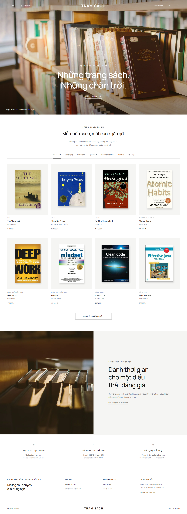

# Trạm Sách

Shop sách **Java 21 / Spring Boot 3.5.16**, kiến trúc **Modular Monolith + Layered**. Giao diện Spring MVC + Thymeleaf, PostgreSQL trên Neon, Spring Security, Spring Session JDBC, Flyway, COD và Stripe **sandbox**.

**Tác giả:** [nghiahnc](https://github.com/nghiahnc) · **[Mã nguồn](https://github.com/nghiahnc/shop-sach-java)**



**Demo:** https://shop-sach-java.vercel.app · **Health:** `/health` · **Admin:** `/admin`

18 sách có thật, 6 thể loại, ảnh bìa đúng ISBN lưu cục bộ. Giao diện biên tập tối giản lấy cảm hứng bố cục Louis Vuitton. Giá, địa chỉ trình diễn và giao dịch là dữ liệu mẫu. Không thu tiền thật hay giao hàng thật.

## Demo điền sẵn

Bản online bật `DEMO_MODE=true`. Tài khoản CUSTOMER công khai: **demo@tramsach.demo / TramSachDemo2026!**. Màn hình đăng nhập đã điền sẵn; đăng ký sinh email UUID mới mỗi lần mở. Sau đăng ký, màn hình đăng nhập giữ email vừa tạo. Checkout có người nhận/địa chỉ giả lập và chọn Stripe. Số lượng mặc định 1; mã `DOCSACH10` điền sẵn trong giỏ, bấm **Áp dụng** để tính giảm.

Stripe sandbox hiển thị Visa **4242** đã lưu: chọn/xác nhận rồi bấm **Pay**. Không cần gõ số thẻ, ngày hoặc CVC trong luồng chính. Mỗi tài khoản có Customer và PaymentMethod riêng, tạo bằng token test `tok_visa`; database chỉ lưu hai ID. Không gửi tự động hoặc dùng thẻ thật. Có thể chọn thẻ khác để thử từ chối. Tắt `DEMO_MODE` để bỏ dữ liệu điền sẵn và ngừng cấp thẻ mẫu. Nút “Nhập tài khoản khác / quản trị” xóa các trường đăng nhập; mật khẩu quản trị không được đưa vào HTML.

Ảnh/ấn bản và nguồn: [ASSET_SOURCES.md](docs/ASSET_SOURCES.md), `src/main/resources/book-assets.json`. V4 chỉ sửa tên/tác giả/giới thiệu của 18 UUID ban đầu; V5 thêm bảng tham chiếu thẻ sandbox. Đơn đã mua giữ snapshot cũ.

## Chạy từ bản mã nguồn sạch

```powershell
git clone https://github.com/nghiahnc/shop-sach-java.git
cd shop-sach-java
```

Cài JDK 21, đặt `JAVA_HOME`, sau đó `./mvnw verify` (Linux/macOS) hoặc `./mvnw.cmd verify` (Windows). Tạo database PostgreSQL riêng của bạn, không dùng database của demo công khai. Sao chép các tên biến trong `.env.example` vào môi trường tiến trình. Spring Boot **không tự đọc file .env**.

```powershell
$env:DB_URL = 'jdbc:postgresql://HOST-pooler/DB?sslmode=verify-full&sslfactory=org.postgresql.ssl.DefaultJavaSSLFactory'
$env:DB_DIRECT_URL = 'jdbc:postgresql://HOST/DB?sslmode=verify-full&sslfactory=org.postgresql.ssl.DefaultJavaSSLFactory'
$env:DB_USER = 'YOUR_ROLE'
$env:DB_PASSWORD = 'YOUR_PASSWORD'
$env:ADMIN_EMAIL = 'admin@example.test'
$env:ADMIN_PASSWORD = 'YOUR_STRONG_DEMO_PASSWORD'
$env:CUSTOMER_EMAIL = 'reader@example.test'
$env:CUSTOMER_PASSWORD = 'YOUR_STRONG_DEMO_PASSWORD'
java -jar target/tram-sach-1.0.0.jar
```

Flyway chạy migration phiên bản; Hibernate chỉ `validate`, không tự sửa schema. Tài khoản bootstrap chỉ được tạo nếu chưa tồn tại. Muốn thử Stripe cần cấu hình khóa `sk_test_…`, webhook secret và `APP_BASE_URL`; khi thiếu khóa, COD vẫn chạy còn Stripe hiển thị lỗi có thể thử lại.

## Kiểm thử

- `./mvnw test`: unit test và ArchUnit, không cần database.
- `./scripts/test.ps1`: chạy cả integration test trên **nhánh Neon test riêng**. Cần `.local/env-test.json` và `.local/env-production.json`; bộ test từ chối khi hai JDBC URL giống nhau.
- Tự tạo hai file JSON cấu hình trong `.local/` (chỉ lưu ở máy), dùng các tên biến trong `.env.example`: một bộ cho database test riêng và một bộ cho production để bảo vệ nhầm môi trường. `TRAM_SACH_TEST=isolated` bật integration test; script PowerShell thiết lập biến này.
- Integration test tạo fixture có tiền tố `IT` và email `it-…` trên nhánh test. Không trỏ nhánh này sang production.
- `node scripts/qa-redesign.cjs http://localhost:8080`: kiểm tra giao diện, phân quyền, COD và admin bằng Playwright/Edge. Cài công cụ QA bằng `npm install`, dùng `npm ci` cho lần sau; Node không thuộc runtime của shop.
- `artifacts/` chứa ảnh, log và bằng chứng thực thi. Đọc [QA.md](docs/QA.md) để phân biệt kiểm thử mock gateway và giao dịch Stripe sandbox thực tế.

## Neon và Vercel

Project Neon riêng `shop-sach-java`, có các nhánh `production`, `development`, `test`. Ứng dụng dùng pooled JDBC (Hikari tối đa 5); Flyway dùng direct JDBC; TLS kiểm tra chứng chỉ và hostname qua Java trust store. Session, giỏ hàng, đơn và sự kiện thanh toán được lưu trong PostgreSQL.

Vercel chạy `Dockerfile.vercel`: Maven/JDK 21 build JAR, JRE 21 chạy bằng user không phải root, cổng `PORT=8080`, shutdown mềm. Cấu hình `framework: container` là bắt buộc; không đặt `framework: null`. [Container Runtime hiện là Beta](https://vercel.com/docs/functions/runtimes/container).

```powershell
npx vercel@64.3.1 --prod
```

Tạo project Vercel riêng và cấu hình biến môi trường bằng bảng điều khiển/CLI trước khi deploy. Không dùng lại project ID, database hoặc webhook của các shop khác. `tools/configure_deploy.cjs` là helper của workspace này, phụ thuộc tài khoản CLI đã đăng nhập; không phải điều kiện để chạy mã nguồn sạch.

Stripe webhook: `POST /payments/stripe/webhook`, chọn các event Checkout completed/expired/async payment succeeded/failed. Dùng secret **riêng của endpoint**, không dùng secret của Stripe CLI. Local có thể dùng `stripe listen --forward-to localhost:8080/payments/stripe/webhook` và đặt secret mà CLI cung cấp.

## Quy tắc nghiệp vụ

- VND là số nguyên `long`; giá và tổng luôn tính lại phía máy chủ. Một mã giảm giá mỗi đơn; tính ship trên tiền hàng sau giảm. Ship 20.000đ, miễn phí từ 300.000đ; chưa có thuế.
- COD giữ/trừ tồn khi tạo đơn. Chỉ hủy trước giao; hoàn tồn một lần. Chỉ hoàn tất giao hàng mới ghi nhận đã thu.
- Stripe giữ tồn khoảng 30 phút (thêm 60 giây để đáp ứng mức tối thiểu 30 phút của Stripe lúc gọi API). Một đơn dùng một khóa idempotency và một phiên Checkout. Thẻ bị từ chối có thể thử lại trên cùng phiên.
- Chữ ký webhook được kiểm tra trên raw body; xác minh lại trạng thái tại Stripe trước transaction. Sự kiện được ghi cùng transaction cập nhật đơn. Redirect thành công không tự đánh dấu paid.
- Webhook và đối soát lúc checkout/admin/kiểm tra thanh toán xác nhận paid hoặc expired. Lỗi mạng không tự hoàn tồn; lần sau tiếp tục đối soát. Không dùng timer RAM cho tồn kho.
- VND là mặc định. Có thể cấu hình `STRIPE_CURRENCY=usd` nếu tài khoản test không hỗ trợ VND: 26.000đ/USD cố định, làm tròn lên cent; hiển thị trước checkout và lưu số tiền/currency đã gửi Stripe. Đây không phải tỷ giá thị trường.
- Chưa có refund, upload ảnh, tích hợp vận chuyển, email, đánh giá hay ebook. Đơn thẻ đã trả tiền không được hủy trong v1.

Đọc [kiến trúc và UML](docs/ARCHITECTURE.md), [kịch bản phỏng vấn](docs/DEMO.md) và [kết quả kiểm chứng](docs/QA.md).

## Tải trang và cache

Bản tối ưu cache trang chủ/giới thiệu tại CDN, tách context giỏ/tài khoản thành API private. Static có URL theo hash nội dung và cache immutable. Public HTML không chứa CSRF hay dữ liệu người dùng; form lấy token đúng phiên khi bấm. Danh mục, chi tiết và luồng mua vẫn kiểm tra dữ liệu ở máy chủ.

Docker dùng `-XX:TieredStopAtLevel=1` sau benchmark. Cache MISS và trang động vẫn có thể chờ Java thức dậy trên Vercel Hobby. Số đo trước/sau, phép thử sáu phút nghỉ và giới hạn: [PERFORMANCE.md](docs/PERFORMANCE.md).

```powershell
node scripts/qa-performance-interactions.cjs http://localhost:8080 artifacts/performance-development
node scripts/measure-load.cjs https://shop-sach-java.vercel.app after
node scripts/measure-idle.cjs
python scripts/report-performance.py
```

Không truy cập app hoặc chạy QA khác trong cửa sổ sáu phút của phép đo idle. Không dùng keepalive hoặc tự gửi lại POST/thanh toán.

## Nội dung công khai

Repo giữ source, Maven Wrapper, migration, test, nguồn ảnh/font và một số ảnh/số đo đã rà soát. JAR/ZIP, log thô, tài khoản quản trị riêng, URL Checkout đầy đủ, cookie và cấu hình `.local/` không đưa vào Git. Build JAR từ source bằng Maven Wrapper; các con số kiểm thử lịch sử nằm trong tài liệu QA và PERFORMANCE.
