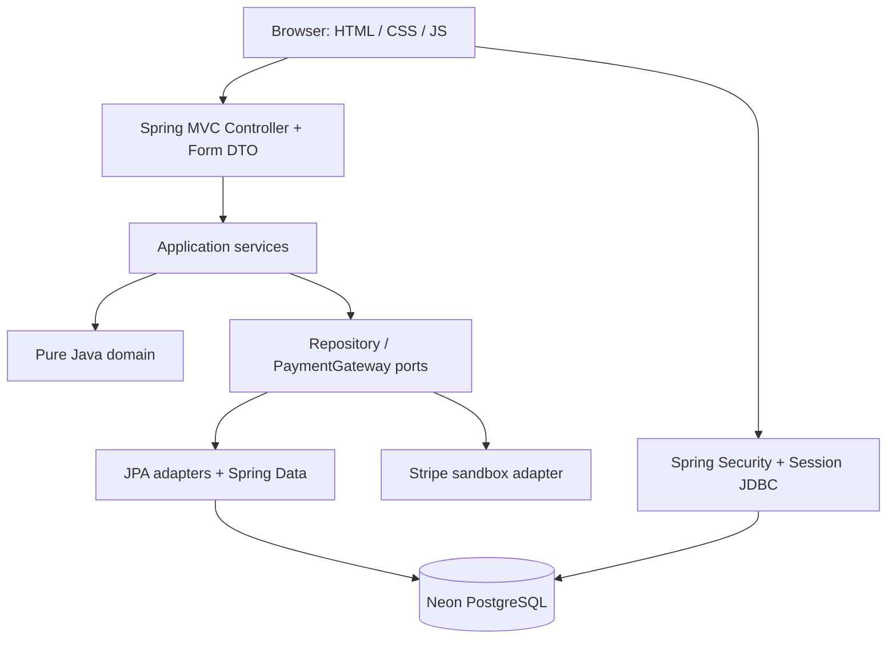
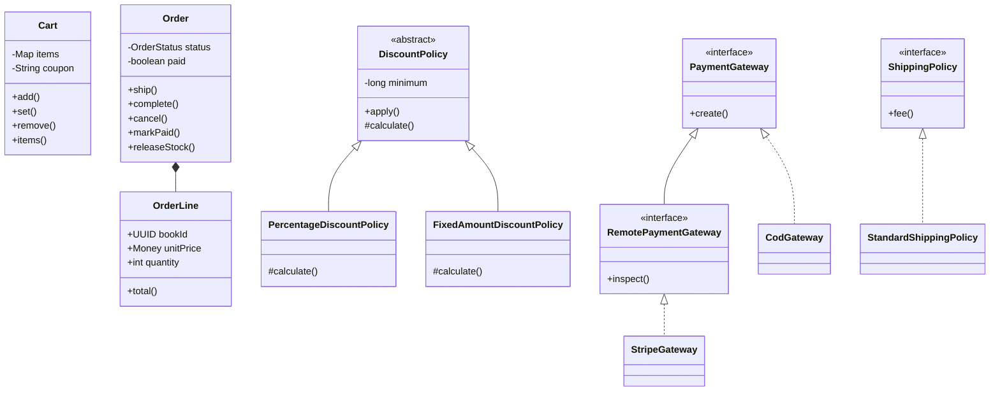
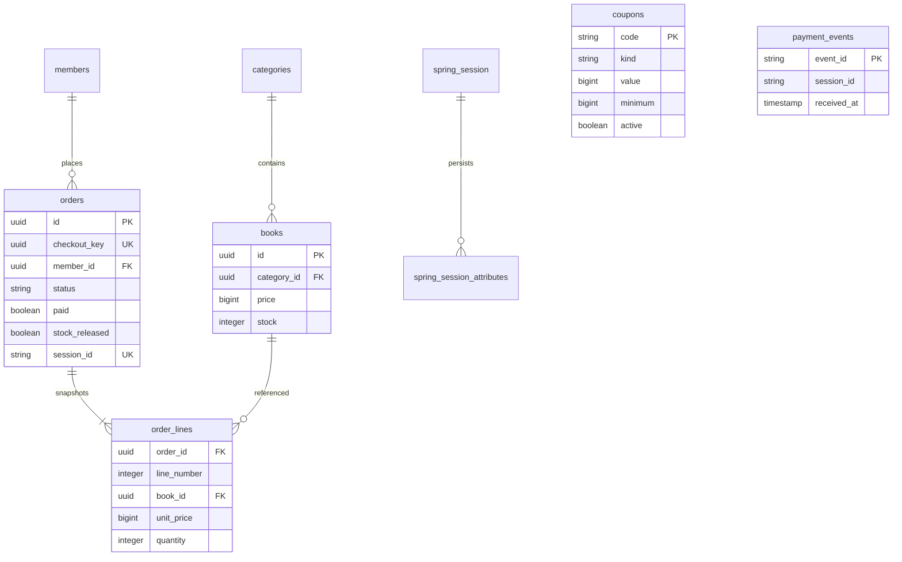
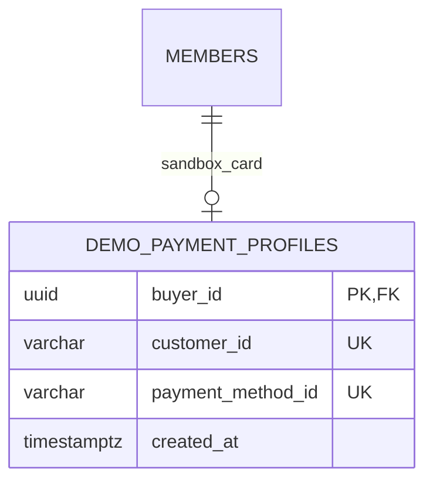

# Architecture: Modular Monolith + Layered

Một tiến trình Java, một PostgreSQL, chia package theo nghiệp vụ. Tránh microservices cho quy mô demo để transaction đơn hàng/tồn kho có thể kiểm chứng rõ ràng.



## Module và dependency

| Module        | Trách nhiệm                                              | Tương tác                                           |
| ------------- | -------------------------------------------------------- | --------------------------------------------------- |
| catalog       | Danh mục, tìm kiếm, cập nhật sách, khóa/hoàn tồn         | JPA + Spring Data adapter                           |
| identity      | Đăng ký, mật khẩu BCrypt, CUSTOMER/ADMIN, khóa người đặt | Repository port; UserDetailsService                 |
| cart          | Đóng gói giỏ, báo giá, phí giao, session facade          | CatalogService, PromotionService                    |
| promotions    | Mã, điều kiện, chính sách giảm                           | CouponRepository                                    |
| orders        | Transaction đặt đơn, snapshot, trạng thái, quyền sở hữu  | IdentityService, CatalogService, CartPricingService |
| payments      | Gateway, đối soát, sự kiện idempotent                    | OrderService, Stripe/COD adapter                    |
| admin         | HTTP quản trị được Spring Security bảo vệ                | Application services của các module                 |
| shared/config | Money, lỗi nghiệp vụ, cấu hình và định dạng giao diện    | Không chứa nghiệp vụ bán hàng                       |

Controller không truy cập entity, EntityManager hoặc repository. Application chỉ phụ thuộc port/domain và application service khác. Domain chỉ dùng Java và domain khác. Adapter phụ thuộc domain, không đảo chiều. `ArchitectureTest` kiểm tra bốn ràng buộc này.

## OOP dùng ở đâu?



- **Encapsulation:** tập item chỉ đọc; không có setter trạng thái đơn. Điều kiện chuyển trạng thái nằm trong aggregate.
- **Abstraction:** port repository và gateway không biết chi tiết SQL/HTTP.
- **Inheritance + Template Method:** `DiscountPolicy.apply` kiểm tra điều kiện chung; lớp con chỉ tính mức giảm.
- **Interface segregation:** COD chỉ thực hiện tạo hướng dẫn thanh toán; riêng gateway online cung cấp truy vấn trạng thái qua `RemotePaymentGateway`, không buộc COD có phương thức không hỗ trợ.
- **Polymorphism + Strategy:** hai chính sách giảm và hai gateway được gọi qua kiểu chung.
- **Composition:** Order chứa immutable OrderLine; không tạo cây kế thừa User/Admin để minh họa hình thức.
- **Value Object:** Money không âm, dùng checked arithmetic; Delivery kiểm tra dữ liệu; đơn snapshot tên và giá.

## Đặt đơn và thanh toán

```mermaid
sequenceDiagram
  participant U as Customer
  participant C as Controller
  participant O as OrderService
  participant D as Neon
  participant P as PaymentService
  participant S as Stripe
  U->>C: POST checkout + CSRF + checkout key
  C->>O: place(...)
  O->>D: Lock member; lookup unique checkout key
  O->>D: Lock books in UUID order; reserve stock
  O->>D: Save order + snapshots; COMMIT
  C->>P: start(order)
  P->>S: Create Checkout (order UUID idempotency key)
  P->>D: Persist session + charged amount
  C-->>U: Redirect hosted sandbox checkout
  S->>C: Signed webhook
  C->>S: Retrieve authoritative session
  C->>D: Claim unique event; lock order; update paid; COMMIT
```

Không giữ DB transaction trong lúc gọi Stripe. Nếu Stripe thành công nhưng kết nối/ghi session lỗi, gọi lại cùng idempotency key và cùng tham số để lấy lại phiên. Nếu kết quả còn mơ hồ thì giữ tồn và đối soát tiếp; chỉ trả tồn khi nhà cung cấp xác nhận expired hoặc xác định phiên chưa được tạo sau hết hạn. Phiên quá 24 giờ chưa đối soát cần xem thủ công do giới hạn lưu idempotency của nhà cung cấp; không tự giải phóng trên lỗi mạng.

Khóa native `SELECT id … FOR UPDATE` cho parent Order trước khi hydrate collection, tránh stale state do follow-on locking của Hibernate. Khi hủy/hết hạn, đánh dấu `stockReleased` và hoàn tồn trong cùng transaction. Việc lặp, đồng thời hoặc khởi động lại không được cộng tồn hai lần.

## ERD



Session chứa Cart, checkout UUID và Spring Security context, được JDBC serialize vào Neon; không cần sticky session. Cookie HttpOnly, SameSite=Lax, HTTPS tự dùng Secure. CSP chỉ cho tài nguyên cùng origin, form chuyển Stripe; mọi form ghi dữ liệu có CSRF, chỉ webhook được miễn CSRF và thay bằng chữ ký.

## Giới hạn có chủ đích

Một Maven module, không Redis/message broker; truy vấn danh mục và lịch sử đọc vào bộ nhớ phù hợp dữ liệu demo nhỏ. Chưa tối ưu cho hàng triệu sản phẩm/đơn. Không lưu dữ liệu thẻ. Chưa triển khai refund, outbox worker hoặc vận chuyển thật. Đối soát dựa trên webhook và lượt truy cập, nên việc hoàn tồn không có cam kết chạy đúng giây khi cửa hàng không có traffic.

## Demo defaults và thẻ sandbox lưu sẵn

`DemoDefaults` chứa fixture công khai, chỉ bật qua `DEMO_MODE`. Controller chỉ cấp mặc định trên GET; POST validation dùng lại form đã gửi. Đăng ký tạo email UUID, không tái sử dụng một email cố định. Tài khoản quản trị riêng không được đọc vào fixture.

`StripeGateway → DemoCardService → DemoCardRepository / DemoCardProvisioner`. `StripeDemoCardProvisioner` tạo Customer, tokenized PaymentMethod và attach bằng các idempotency key riêng theo buyer UUID; chỉ chấp nhận `sk_test_`. `JpaDemoCardAdapter` có transaction ngắn và INSERT ON CONFLICT; không giữ transaction database trong lúc gọi Stripe. Checkout truyền Customer + allow_redisplay=always để Stripe hiển thị thẻ đã lưu.



Không lưu PAN, CVC, ngày hết hạn hoặc thông tin thẻ thật. Phiên Checkout vẫn có idempotency theo order, webhook riêng và kiểm tra amount/currency/session. Hạn 31 phút gồm 60 giây chuẩn bị để đáp ứng giới hạn tối thiểu 30 phút lúc gửi API.

V4 cập nhật metadata của 18 sách, giữ nguyên UUID, tồn, giá và bảng order_lines. Ảnh WebP/font phục vụ từ ứng dụng, không phụ thuộc request ảnh bên thứ ba lúc demo. Manifest ISBN/nguồn ảnh nằm trong book-assets.json.

## Public rendering và session context

Security chain GET/HEAD `/`, `/about`, static không tải SecurityContext từ session. Controller advice không tạo HttpSession. Public HTML chứa danh mục và placeholder cho header, không có CSRF token hay dữ liệu cá nhân, nên có thể cache chung tại Vercel. `/storefront/context` dùng security chain thông thường, đọc phiên hiện có và trả DTO riêng no-store. `/storefront/csrf` chỉ tạo token khi thao tác cần POST; không tắt CSRF cho mutation.

ResourceUrlEncodingFilter, VersionResourceResolver và CssLinkResourceTransformer tạo URL theo nội dung cho template/CSS. Trang công khai cache 60 giây, revalidate nền tối đa 600 giây; tài nguyên có hash immutable. Trang riêng, redirect và error không cache. CatalogRepository bổ sung featured(limit); adapter JOIN category và LIMIT tại SQL, domain không phụ thuộc JPA. Khóa và cập nhật tồn vẫn dùng cổng cũ.

Client không giữ context/token bền vững. pageshow/BFCache đọc lại context và xóa token cũ sau đổi phiên; lỗi lấy token không tự gửi POST. Xem [PERFORMANCE.md](PERFORMANCE.md) để biết số đo và giới hạn cold start.
